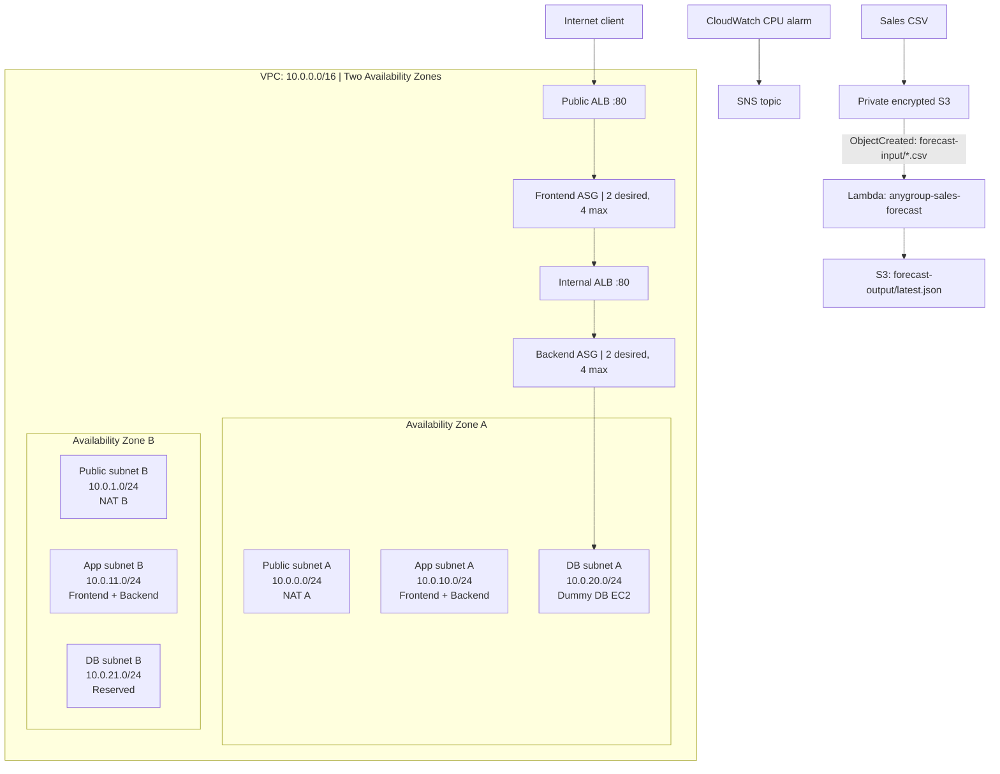

# INFOSYS 735 - Assignment 2 | AnyGroupLLC AWS Learner Lab Prototype

> **Project status (12 October 2026):** The infrastructure-as-code, validation scripts, architecture notes, and presentation materials are committed in this repository. The stack was previously deployed and tested for the project, but **its current live AWS state has not been reverified**: the last local AWS CLI check returned `ExpiredToken`, and the previously recorded ALB hostname did not resolve. Restart the Learner Lab, refresh temporary credentials, and rerun verification before recording a new demo. A successful past demo is not proof that the environment is still running.

This repository documents the implementation of the **AnyGroupLLC** cloud architecture proposed in INFOSYS 735 Assignment 1. Assignment 2 turns that design into a reproducible **AWS Academy Learner Lab prototype** and evaluates the decisions against the AWS Well-Architected Framework.

The purpose is not to claim a production-ready e-commerce platform. It is to demonstrate, with deployed resources and repeatable checks, the feasibility of network isolation, multi-AZ application availability, load balancing, Auto Scaling, infrastructure automation, monitoring, and an event-driven business feature.

## Contents

1. [Objectives and assignment deliverables](#objectives-and-assignment-deliverables)
2. [Architecture and request flow](#architecture-and-request-flow)
3. [Production design versus Learner Lab implementation](#production-design-versus-learner-lab-implementation)
4. [Assignment 1 feedback: provisional production sizing](#assignment-1-feedback-provisional-production-sizing)
5. [AWS resources implemented](#aws-resources-implemented)
6. [Network and security design](#network-and-security-design)
7. [Compute, load balancing, and resilience](#compute-load-balancing-and-resilience)
8. [Additional feature: sales forecasting](#additional-feature-sales-forecasting)
9. [Monitoring and operations](#monitoring-and-operations)
10. [Well-Architected Framework review](#well-architected-framework-review)
11. [Learner Lab setup and deployment](#learner-lab-setup-and-deployment)
12. [Verification and presentation evidence](#verification-and-presentation-evidence)
13. [Problems encountered and design decisions](#problems-encountered-and-design-decisions)
14. [Costs, limitations, and cleanup](#costs-limitations-and-cleanup)
15. [Four-person presentation plan](#four-person-presentation-plan)
16. [Repository guide](#repository-guide)

## Objectives and assignment deliverables

The business case calls for an infrastructure platform supporting an online business with seasonal traffic, customer-data protection, limited IT operations capacity, and a CFO interested in forecasting and cost visibility.

| Stakeholder concern | Architectural response | Prototype evidence |
| --- | --- | --- |
| Availability during seasonal promotions | Two AZs, public/internal ALBs, frontend/backend Auto Scaling Groups | EC2 target health, ASG placement and live HTTP request chain |
| Security and data exposure | Tier-specific Security Groups, private application/database subnets, private encrypted S3 | VPC routes, Security Groups and S3 settings |
| Small operations team | CloudFormation, scripted deployment, validation and teardown | Stack resources and shell scripts |
| Financial discipline | Lab-sized dummy compute, reproducible cleanup, production/lab separation | CloudFormation sizing and cleanup script |
| Demand forecasting | S3 event notification invokes Python Lambda; generated forecast stored in S3 | Input CSV, Lambda, output JSON and logs |

### Official marking outline (100%)

The four grading components below use the exact labels and weights from the Assignment 2 brief. Each row links the requirement to concrete implementation and presentation evidence.

| Official marking criterion | Weight | How our solution addresses it | Evidence to include |
| --- | ---: | --- | --- |
| **Solution improvement** | **10%** | Improve the Assignment 1 architecture using AWS Well-Architected trade-offs and add a business-facing forecasting workflow. Explain what changed and why. | Updated architecture, [Well-Architected review](well_architected_review.md), [provisional production instance sizing](#assignment-1-feedback-provisional-production-sizing), production-versus-lab comparison |
| **Infrastructure implementation (Basic)** | **30%** | Build VPC networking, two AZs, six subnets, routing, NAT, Security Groups/NACLs, public/internal ALBs, frontend/backend ASGs, EC2 dummy DB and private S3. | CloudFormation Resources, subnet/route and security views, target health, ASG instances, live `/`, `/api/` and `/api/db/` results |
| **Infrastructure implementation (Additional)** | **20%** | Implement event-driven sales forecasting with S3 + Lambda and infrastructure monitoring using CloudWatch + SNS. | Upload `sample-sales.csv`, show Lambda trigger/execution and generated `forecast-output/latest.json`, inspect CloudWatch alarm and SNS topic |
| **Presentation** | **40%** | Explain the architecture, business rationale, technical choices, trade-offs and working implementation with a coherent four-speaker pitch. | PDF/slides plus a recorded AWS Console walkthrough with substantial live-system evidence |

**Grading priority:** 50% of marks relate to implemented infrastructure, 40% to the presentation, and 10% to solution improvement. Slides alone cannot substitute for demonstrating functioning services. The grading rubric above does not imply that every listed component is currently live; verify the Learner Lab first (see [Verification and presentation evidence](#verification-and-presentation-evidence)).

**Submission checklist:**

- Presentation slides or PDF including the **final architecture diagram with the additional feature**, and an explanation of Well-Architected decisions.
- Separate **plain-text file containing the presentation recording URL** (e.g. shareable Zoom/YouTube/Google Drive/OneDrive link).
- **Every member completes TeamMates peer assessment for all teammates**. The assignment brief states a **10% penalty** for failing to do so.

The video should spend a substantial portion of its duration **demonstrating functioning AWS components in the management console**, not simply reading the slide deck. The course instructions allow a constrained prototype where restricted services or budget prevent full production parity.

## Architecture and request flow

### High-level deployed prototype



This is a **logical topology**; the two ASGs place instances in both application subnets, and the ALBs span their configured subnets. The **dummy DB EC2 lives only in DB subnet A**, so this is *not* a Multi-AZ database deployment. The detailed diagram is also in [architecture_diagram.md](architecture_diagram.md).

### HTTP request path

```text
Internet -> Public ALB -> Frontend EC2 (ASG)
                        -> Internal ALB -> Backend EC2 (ASG)
                                        -> Dummy DB EC2 on private IP:8080
```

| Public endpoint path | Intended observation | What this proves |
| --- | --- | --- |
| `/` | Prototype HTML homepage | Internet-facing ALB forwards to the frontend |
| `/api/` | Backend JSON response | Frontend can proxy through the internal ALB to the backend |
| `/api/db/` | JSON from dummy DB service | Backend can reach the isolated database **simulation** |

The original ALB hostname shown in older notes is **historical, not a permanent URL**. Obtain the current `PublicAlbDns` CloudFormation output following deployment. The stack exposes port 80 **over HTTP**, not HTTPS; this is strictly a lab demo.

## Production design versus Learner Lab implementation

Assignment 1 described an intended production architecture. Assignment 2 intentionally implements a smaller version in the services and region exposed by Learner Lab.

| Design concern | Assignment 1 production recommendation | Assignment 2 lab reality |
| --- | --- | --- |
| Region | New Zealand `ap-southeast-6` when available | `us-east-1` (lab account could not use the proposed region) |
| DNS and CDN | Route 53 + CloudFront | Not deployed |
| Edge security | AWS WAF + Shield | Not deployed |
| Internet ingress | Public Application Load Balancer | **Deployed in template**, HTTP listener |
| Frontend | Apache on Linux in an ASG | Linux EC2 running a lightweight Python HTTP server in an ASG |
| Backend | .NET Core on Windows in an ASG | Linux EC2 running a lightweight Python HTTP server in an ASG |
| Internal routing | Internal ALB | **Deployed in template** |
| Database | RDS for Oracle Multi-AZ | **Single EC2 dummy HTTP endpoint**, no actual Oracle/RDS or replication |
| Image/catalogue storage | Private S3 with CloudFront OAC | Private encrypted S3 also used for forecast data; no image application workflow |
| Operations | Automated provisioning, alerting and controls | CloudFormation, scripts, CloudWatch alarm and SNS topic |
| Additional feature | Forecasting concept for CFO | S3-triggered Python Lambda and output JSON |

**Do not equate simulated application/database tiers with production Oracle/.NET functionality or compliance.** The substitution is intentional under Learner Lab restrictions and budget.

## Assignment 1 feedback: provisional production sizing

In the feedback dated **12 October 2026**, Yi-Chien Vita Tsai described the multi-AZ architecture, stakeholder coverage, security and reliability as strong, while recommending one concrete improvement: **name a provisional EC2 instance type for each tier and an initial RDS instance class**.

We have now translated that feedback into the following **starting production sizing assumptions** (not production deployments or measured sizing results).

| Tier (production) | Provisional starting class | Capacity per instance | Initial architecture and rationale | Learner Lab actual configuration |
| --- | --- | --- | --- | --- |
| Frontend - Apache on Linux | **EC2 `t3.medium`** | **2 vCPU, 4 GiB RAM** | Start with **2 instances across 2 AZs** behind the public ALB; the burstable class is an initial cost-conscious choice for variable frontend traffic. Monitor CPU-credit balance during sustained campaigns and consider a non-burstable class if needed. | `t3.micro` Linux/Python simulator in the frontend ASG |
| Backend - .NET Core on Windows | **EC2 `m6i.xlarge`** | **4 vCPU, 16 GiB RAM** | Start with **4 instances across 2 AZs** behind the internal ALB (matching the existing fleet's server count and nominal per-host memory); benchmark Windows/.NET utilization and AWS licensing before resizing. Physical CPUs are not directly comparable with vCPUs. | `t3.micro` Linux/Python simulator in the backend ASG (2 desired) |
| Database - Oracle on Amazon RDS | **RDS `db.m6i.2xlarge`**, 2 TiB initial storage target | **8 vCPU, 32 GiB RAM** | **RDS for Oracle 19c, Multi-AZ** baseline aligned more closely with the case's 8-CPU / 32-GB / 2-TB system. Confirm compatible edition, license, IOPS, storage allocation, region and failover. The standby does **not** double read-serving capacity. | **Single** `t3.micro` EC2 dummy HTTP endpoint; no Oracle, RDS or DB failover |

**Sizing caveat:** Assignment 1's existing estate lists **two frontend Linux hosts at 2 CPUs / 4 GB each**, **four backend Windows hosts at 4 CPUs / 16 GB each**, and **one Oracle server at 8 CPUs / 32 GB and 2 TB storage**. The revised production assumptions retain that context instead of arbitrarily reducing memory and server count. These are still planning estimates, not right-sizing test results.

**Why this qualifies as a design improvement:** the original Assignment 1 diagram specified the deployment pattern and technology choices but left instance classes unspecified. Assigning explicit, reviewable starting sizes makes the design easier to cost, capacity-plan and test without pretending that the Learner Lab dummy servers are production equivalents.

**Validation gates before committing to production:**

1. Confirm EC2 and RDS class availability in the target AWS Region (proposed `ap-southeast-6`) and verify Oracle 19c **edition, licensing, Multi-AZ support and commercial terms**.
2. Load-test baseline and seasonal-peak traffic across frontend/backend. Observe CPU, memory, latency, ASG scaling, and **T3 CPU credits**; right-size or switch instance families if sustained utilization invalidates burstable assumptions.
3. Benchmark Oracle memory, storage, IOPS, connection limits, backup/restore, RTO/RPO and failover behavior with **representative migrated data**.
4. Compare projected compute, Windows/Oracle licensing, NAT/ALB/network, storage and operational costs against the CFO's budget before committing.

**Boundary:** these are **provisional production recommendations only**. No change to `template.yaml` is required; the Learner Lab continues to use `t3.micro` and a dummy database to stay within its restrictions and budget. AWS RDS documentation lists `db.m6i.2xlarge` among supported classes for Oracle 19c, but this does not guarantee availability for every Region, engine edition or license configuration.

**AWS reference:** [RDS for Oracle DB instance classes](https://docs.aws.amazon.com/AmazonRDS/latest/UserGuide/Oracle.Concepts.InstanceClasses.html) and [RDS hardware specifications](https://docs.aws.amazon.com/AmazonRDS/latest/UserGuide/Concepts.DBInstanceClass.Summary.html).

## AWS resources implemented

The following reflects **`template.yaml`**, not a claim that these resources are currently live.

| Area | CloudFormation-defined implementation | Notes |
| --- | --- | --- |
| Networking | 1 VPC `10.0.0.0/16`, 6 subnets across 2 AZs, Internet Gateway | Public, application and database subnet in each AZ |
| Egress | 2 NAT Gateways and 2 Elastic IPs | Each app AZ routes through its corresponding NAT; chargeable resources |
| Routing | Public route table, 2 app route tables, isolated DB route table | DB route table has **no default route to the Internet** |
| Network controls | 3 custom NACLs, 5 tier-specific Security Groups | Public ALB, frontend, internal ALB, backend, dummy DB |
| Load balancing | 2 ALBs, 2 target groups, 2 HTTP listeners | `anygroup-public-alb`, `anygroup-internal-alb` |
| Auto Scaling | Frontend ASG + backend ASG, each 2 desired / 2 min / 4 max | 4 application EC2 instances at steady state |
| Database simulation | 1 private dummy DB EC2 | Single point of failure in lab; not an actual DBMS |
| Compute image | Configurable AMI and `t3.micro` default | `t2.micro` also allowed by parameter |
| Object storage | 1 encrypted, non-public S3 bucket | Bucket name derived from AWS account and region |
| Serverless | Python 3.12 Lambda `anygroup-sales-forecast` | Triggered by S3-created CSV files |
| Observability | 5-minute CloudWatch high-CPU alarm + SNS topic, optional email subscription | Confirm the SNS email subscription and test delivery separately |
| IAM | Lab-provided `LabRole` and `LabInstanceProfile` | No custom IAM principals created |

The deployed resource list and generated identifiers can be inspected from the **CloudFormation Resources and Outputs tabs**. Counts above refer to the defined architecture; Auto Scaling can create more instances under load.

## Network and security design

### Subnet address plan

| Zone | Public | Application (private) | Database (private) |
| --- | --- | --- | --- |
| AZ A | `10.0.0.0/24` | `10.0.10.0/24` | `10.0.20.0/24` |
| AZ B | `10.0.1.0/24` | `10.0.11.0/24` | `10.0.21.0/24` |

- The **public route table** sends `0.0.0.0/0` to the Internet Gateway; the public ALB and NAT Gateways use public subnets.
- The **application route table per AZ** sends outbound Internet traffic through the NAT Gateway in the same AZ. Instances in these private subnets do not need public addresses.
- The **database route table** contains VPC-local routing only. Neither DB subnet receives an Internet default route.
- Custom NACLs provide subnet-level controls; the Security Groups provide the principal tier-to-tier restrictions. The public-subnet NACL now allows **inbound TCP 443 from the VPC** for private-instance traffic forwarded through each NAT; port 1024-65535 permits return traffic. A real HTTPS egress test from **each AZ** is still required.

### Security Group trust chain

| Resource | Allowed inbound traffic |
| --- | --- |
| Public ALB | HTTP TCP 80 from `0.0.0.0/0` |
| Frontend EC2 | TCP 80 **only from Public ALB SG** |
| Internal ALB | TCP 80 **only from Frontend SG** |
| Backend EC2 | TCP 80 **only from Internal ALB SG** |
| Dummy DB EC2 | TCP 8080 **only from Backend SG** |

S3 is protected by **Block Public Access** and **SSE-S3 (AES256)** server-side encryption. The demo does not expose a publicly readable S3 website.

**Security boundary:** this proves network segmentation and storage defaults; it does **not** prove PCI DSS compliance, payment security, HTTPS/TLS, WAF/DDoS policy effectiveness, application vulnerability management, production IAM least privilege, or full audit logging.

## Compute, load balancing, and resilience

1. The **public ALB** distributes external requests to `anygroup-front-tg`.
2. Frontend instances proxy `/api/*` to the **internal ALB**.
3. The internal ALB sends requests to `anygroup-back-tg`.
4. Backend instances access the simulated database over its **private IP, port 8080**.
5. Both ASGs span the two application subnets and use **ELB health checks** with a 180-second grace period.
6. Both target groups expect HTTP **200** from `/health`.
7. Both ASGs have **CPU target tracking at 60%**, with 2 minimum/desired and 4 maximum instances.

This provides meaningful **application-tier multi-AZ coverage** and automatic replacement mechanics, but real failover time, restoration targets, sustained throughput, and database high availability still require testing. The single dummy DB and two NATs are important trade-offs.

The EC2 services are intentionally simple Python standard-library HTTP servers started by systemd through Launch Template user data. They are demonstration services, not an Apache/.NET/Oracle production stack.

## Additional feature: sales forecasting

The additional business feature addresses the CFO's interest in demand planning. It is intentionally a **small, reproducible data pipeline**, rather than a production machine-learning forecast.

```text
sample-sales.csv
     |
     v
S3: forecast-input/*.csv
     |  ObjectCreated event
     v
Lambda: anygroup-sales-forecast (Python 3.12)
     |  Parse numeric sales column
     |  Average the last up-to-7 observations
     v
S3: forecast-output/latest.json
```

- **Trigger:** S3 `ObjectCreated:*` notification with prefix `forecast-input/` and suffix `.csv`.
- **Input:** a CSV containing a `sales` column (see [sample-sales.csv](sample-sales.csv)).
- **Input validation:** strictly increasing, **consecutive ISO daily dates** and a finite, non-negative numeric `sales` value in each row; gaps, duplicates, negative values and NaN/infinity are rejected.
- **Calculation:** arithmetic mean of the last **up to seven consecutive daily observations**.
- **Event handling:** S3 object keys are URL-decoded (including spaces and plus signs), and every S3 notification record is processed.
- **Output:** `model`, `source_key`, `result_key`, `observations`, `window_size`, `forecast_date`, `next_day_sales_forecast`, `units` and `generated_at`.
- **Output location:** immutable per-input result at `forecast-output/runs/<input-basename>.csv.json` and a convenience pointer at `forecast-output/latest.json`. Both are outside the triggering prefix.
- **Demo sample:** the last seven sales values in the committed CSV are 515, 540, 528, 560, 590, 575 and 610, yielding a forecast of **559.71** (rounded to two decimals).

**Modelling boundary:** dates must now be consecutive and ordered, but the algorithm remains a **simple seven-day moving average**. It assumes consistent daily sales units, handles neither product/store segmentation nor returns, promotions, holidays, seasonality or stockouts, and has not been validated on representative business data. The CFO's workflow is: **existing system exports daily sales -> S3 -> Lambda -> forecast output -> purchasing staff review replenishment decisions**. No business accuracy or waste-reduction claim has been established.

## Monitoring and operations

- `anygroup-frontend-high-cpu`: CloudWatch CPU alarm at **70% for two five-minute periods**. This aligns with EC2 **basic monitoring** without charging for 60-second detailed monitoring. Scaling remains a separate **60% CPU target-tracking** policy.
- `anygroup-infrastructure-alarms`: SNS topic for alarm actions. An **optional email subscription** is created when `ALARM_EMAIL` is supplied during deployment; the recipient must accept the SNS confirmation email. Without that confirmation, delivery is **not** verified.
- CloudFormation makes resources repeatable and exposes stack outputs for later inspection.
- The repository includes separate deploy, verify and destroy scripts.
- Local forecasting tests: `python3 -m unittest discover -s tests -v` (no AWS account required).

Check actual CloudWatch alarm state and metric availability during the demo. An alarm existing in the console is not evidence that notification delivery was tested. Verify the S3-triggered Lambda invocation by examining the new output object's timestamp and, if available, Lambda/CloudWatch logs.

## Well-Architected Framework review

AWS Well-Architected includes **six pillars**. The project review focuses on four with directly related implementation evidence, while the remaining two are considerations rather than validated results.

| Pillar | Implemented / discussed measures | Residual risk |
| --- | --- | --- |
| **Operational Excellence** | CloudFormation and repeatable deploy/verify/cleanup; systemd service restart | Production runbooks, incident response and observability need expanding |
| **Security** | Layered SGs, private DB route, encrypted private S3, Lab IAM roles | HTTP-only ingress; PCI, WAF, identity policies and audits not proven |
| **Reliability** | Two AZs, public/internal ALBs, healthy-target routing, ASGs, two NATs | Single dummy DB, no tested disaster recovery/RTO/RPO |
| **Cost Optimization** | Small dummy compute, avoid lab RDS/Windows full deployment, cleanup script | ALB/NAT hourly charges and running instances consume budget |
| **Performance Efficiency** | ASG scaling and load balancing are plausible mechanisms | No measured latency/load tests or right-sizing study |
| **Sustainability** | Teardown when idle and small prototype footprint | No environmental/energy metrics or lifecycle measurement |

Read the detailed assessment and trade-offs in [well_architected_review.md](well_architected_review.md).

## Learner Lab setup and deployment

### Prerequisites

- AWS Academy **Learner Lab**, started successfully in the Academy course.
- Active, **temporary Lab credentials** in the local AWS CLI environment. Do **not** commit them or share your AWS Academy login.
- AWS CLI installed in WSL/Linux and available in `PATH`.
- Network access to AWS APIs.
- Available learner budget (the brief describes **USD 50 per student**) and permission to create the required services.

The working project directory used for development was:

```text
/home/samyao/work/infosys735-assignment2
```

The scripts default to **`us-east-1`** and stack **`anygroupllc-a2`**. The Learner Lab account imposes IAM restrictions; the template references the preconfigured `LabRole` and `LabInstanceProfile`.

### Start / renew access — local `.env` (recommended)

1. Open **AWS Academy -> Learner Lab -> Start Lab** and wait for the green ready state.
2. In the AWS Academy Learner Lab **AWS Details -> AWS CLI** section, copy the short-lived three credentials.
3. In the **WSL project folder** (not your Windows GitHub clone), prepare a local configuration file:

```bash
test -f .env || cp .env.example .env  # preserve existing credentials
chmod 600 .env
nano .env
```

4. Either fill `AWS_ACCESS_KEY_ID`, `AWS_SECRET_ACCESS_KEY` and `AWS_SESSION_TOKEN` in `.env`, **or paste the entire AWS Academy `[default]` credentials block** after the settings. The local loader supports both `AWS_ACCESS_KEY_ID=...` and `aws_access_key_id = ...` formats, and does **not** execute the file.
5. Check the session without displaying keys:

```bash
./check-lab.sh
```

Then run `./deploy.sh` and `./verify.sh` as usual. They, along with `./destroy.sh`, now **automatically load the project `.env`**; you no longer need `aws configure` or to manually export variables each time.

**Secrets policy:** `.env` is ignored by Git and should stay permission `600`. Never commit it, share it with classmates, paste it in chat, or include it in a recording. `.env.example` contains **only blank placeholders** and is safe to commit. The example's values are placeholders, not credentials.

Learner Lab credentials **expire**; repeat the three-key replacement after every Lab restart. An `ExpiredToken` error does **not** prove the CloudFormation stack was deleted.

### Deploy

From the repository root:

```bash
chmod +x deploy.sh verify.sh destroy.sh
./deploy.sh
```

`deploy.sh` validates `template.yaml`, deploys CloudFormation, and prints the resulting stack outputs. **Deployment creates billable resources**. Do not repeatedly deploy in separate student accounts solely to record consistent-looking videos.

`deploy.sh` and `verify.sh` both support `AWS_REGION` and `STACK_NAME` (defaults: `us-east-1` / `anygroupllc-a2`). To opt in to email alerts, run `ALARM_EMAIL=your-address@example.com ./deploy.sh` **locally**, then confirm the subscription in that mailbox. Never commit actual credentials or private contact details. If the Lab disallows SNS subscriptions, leave the optional email parameter blank and explain the limitation rather than claiming end-to-end delivery.

### Manual verification

```bash
aws cloudformation describe-stacks \
  --region us-east-1 \
  --stack-name anygroupllc-a2 \
  --query 'Stacks[0].{Status:StackStatus,Outputs:Outputs}'
```

Confirm the stack completes, then use `./verify.sh`. The verifier now **fails on unhealthy target groups, absent cross-AZ instances, incorrect HTTP responses, broken public NACL/NAT resources, missing forecast results, or incompatible alarm configuration**. It uploads the sample to a **unique S3 input key** and waits for that input's **unique output**, so an old `latest.json` cannot give a false positive. It leaves test objects in S3 until cleanup. Optional: `REQUIRE_SNS_DELIVERY=1 ./verify.sh` requires an SNS confirmed subscriber; actual email delivery and load-driven scale-out still require separate live evidence.

For manual application checks, replace `<PUBLIC_ALB_DNS>` with the current CloudFormation output:

```bash
curl -fsS "http://<PUBLIC_ALB_DNS>/"
curl -fsS "http://<PUBLIC_ALB_DNS>/api/"
curl -fsS "http://<PUBLIC_ALB_DNS>/api/db/"
```

Expected evidence to capture:

1. CloudFormation status `CREATE_COMPLETE` or `UPDATE_COMPLETE` and actual resource list.
2. Public and internal ALBs, listeners, and both **healthy** target groups.
3. ASGs with two in-service app instances each, placed across both AZs.
4. VPC subnets/routes and tier Security Groups.
5. Success responses for `/`, `/api/` and `/api/db/`.
6. S3 forecast input and newly generated JSON output, Lambda trigger and logs.
7. CloudWatch alarm and SNS topic **configuration**; distinguish configuration from tested delivery.

If any step fails, report the exact result rather than claiming a successful demo.

## Verification and presentation evidence

### Earlier testing and the current verification boundary

The accompanying [pitch_script.md](pitch_script.md) records a prior successful deployment walkthrough, including an `UPDATE_COMPLETE` stack, two healthy frontend and two healthy backend targets, application-to-DB request path, and forecasting output. Those are **historical project notes**, not fresh AWS API evidence.

**Latest local check (12 October 2026):**
- AWS CLI was installed under `~/.local/bin/aws`.
- `aws sts get-caller-identity` failed with **`ExpiredToken`**.
- Consequently, the live CloudFormation state was **not confirmed**.
- The ALB hostname recorded in the older README was **not resolvable** at the time of checking; fetch a current URL after redeploying.

Before handing in the assignment, take new console evidence while the Learner Lab is active. Record what is actually visible, including unexpected resource states.

### Recommended screen recording structure (~15 minutes)

| Segment | Speaker | Slides + AWS Console evidence | Target |
| --- | --- | --- | ---: |
| Architecture and solution improvement | Member 1 | Business problem, Assignment 1 vs 2, final diagram, CloudFormation resources | 3 min |
| Networking and security | Member 2 | VPC, six subnets, NAT, routes, NACLs, SG chain, private DB | 4 min |
| Reliability and operations | Member 3 | Public/internal ALBs, healthy targets, ASGs, `/`, `/api/`, `/api/db/`, IaC | 4 min |
| Additional feature and business value | Member 4 | CSV upload, Lambda, output JSON, CloudWatch/SNS, costs and conclusion | 4 min |

The **same AWS environment** should be used to capture all four console sections, so resource identifiers and evidence remain consistent. The recording can be assembled asynchronously: one authorized account holder captures real console demonstrations and team members record explanations for their assigned sections. Avoid sharing AWS Academy credentials; confirm the lecturer's recording-format requirements if needed. **Each presenter should understand and be able to explain their section**.

PDF/slides should contain the final architecture (including the S3/Lambda feature) and Well-Architected reasoning; the **video supplies the running-system evidence and technical narration**. See [pitch_script.md](pitch_script.md) for a more detailed walkthrough.

## Problems encountered and design decisions

| Challenge | What happened / design response | Lesson |
| --- | --- | --- |
| Region availability | Proposed New Zealand region could not be selected in the learner environment; used `us-east-1`. | Distinguish educational deployment region from production architecture. |
| IAM restrictions | Lab disallows normal free-form IAM creation; existing `LabRole` / `LabInstanceProfile` used. | Design within sandbox permission limits rather than bypass them. |
| Private instance startup | An early user-data version tried `dnf install httpd` at boot and private instances did not become healthy. Switched to Python standard-library servers already on AMI. | Remove fragile runtime package dependencies from the demo boot path. |
| Multi-tier demonstration | Real .NET/Windows and Oracle would raise complexity and costs. Implemented explicit frontend/backend/dummy DB HTTP chain. | Validate topology without implying application/database parity. |
| Additional feature | Implemented a minimal S3 -> Lambda -> S3 forecast workflow using supplied data. | Demonstrate extensibility and business value while stating analytical limitations. |
| Learner budget | NAT Gateways, ALBs and EC2 accrue charges while running. | Deploy for verification and recording; remove resources afterwards. |
| Temporary credentials | Session expired by the 12 October check; cloud status cannot be assumed. | Reauthenticate before any new live-status claims. |
| Group presentation | One shared implementation, four topic-based speaker sections. | Do not duplicate expensive AWS environments just for individual recordings. |

## Costs, limitations, and cleanup

### Budget awareness

The assignment guidance states **USD 50 per Learner Lab student**. The template provisions two NAT Gateways, two ALBs, four app instances at desired capacity, a dummy DB instance, Elastic IPs, storage and ancillary services. Many resources accumulate charges **even when no one is accessing the site**.

Do not assume AWS Academy pauses or automatically removes chargeable resources when a Lab session ends. Check the learner budget balance and the console before each long recording session. This README intentionally makes **no claim about the exact total spent**, because no final, verified AWS billing report is bundled here.

### Explicit limitations

- Not a real production app, .NET backend, or Oracle database; DB tier is a **single dummy EC2**.
- No production CDN, WAF, Shield integration, HTTPS certificates, or Route 53 domain.
- No proof of PCI DSS compliance; no real payment or personal-data processing.
- No measured failover/recovery times, comprehensive load tests, or backup/restore exercises.
- Daily dates/values are now validated, but the seven-day average is still not a production-tested forecasting model.
- SNS email subscription is optional and must be confirmed; an alarm and topic alone do not prove delivery.
- Current runtime status and budget are unknown until credentials are renewed and checked.

### Teardown after evidence capture

```bash
./destroy.sh
```

**Destructive operation:** `destroy.sh` recursively deletes objects in the stack's forecast S3 bucket, then deletes the CloudFormation stack and waits for completion. Use **only after** saving needed screenshots, console evidence and the demonstration recording. Check CloudFormation deletion finishes successfully and separately inspect any unexpected remaining chargeable resources.

Never upload lab credentials, console secret fields, or other personal data in the recording or repository.

## Four-person presentation plan

These are **presentation responsibilities**, not claims about who implemented the code or statements of equal development contribution.

- **Member 1 - Architecture and solution improvement:** Business motivation, differences between production baseline and lab, full diagram, CloudFormation.
- **Member 2 - Network and security:** VPC, two AZs, public/private subnet design, NAT routing, SG/NACL layers, S3 safeguards.
- **Member 3 - Reliability and operational excellence:** ALBs, ASGs, targets, health checks, request chain, IaC and operational trade-offs.
- **Member 4 - Additional feature and business outcome:** S3/Lambda forecasting, evidence from output JSON, CloudWatch/SNS, budget and remaining production risks.

Every member should review the architecture and expected Console output, not only memorize speaker notes. Complete TeamMates feedback **truthfully based on actual work**.

## Repository guide

| File | Purpose |
| --- | --- |
| [`template.yaml`](template.yaml) | Full CloudFormation template: networking, tier controls, ALBs, ASGs, EC2, S3, Lambda, CloudWatch and SNS |
| [`deploy.sh`](deploy.sh) | Validate and deploy the stack |
| [`verify.sh`](verify.sh) | Check resources, health, HTTP chain, forecasting output and alarm |
| [`destroy.sh`](destroy.sh) | Empty the forecast bucket and delete the stack |
| [`sample-sales.csv`](sample-sales.csv) | Reproducible input to the forecasting pipeline |
| [`architecture_diagram.md`](architecture_diagram.md) | Expanded architecture diagram and production-vs-lab comparison |
| [`well_architected_review.md`](well_architected_review.md) | Pillar-by-pillar analysis, technical justification and limitations |
| [`pitch_script.md`](pitch_script.md) | High-level pitch outline and AWS Console walkthrough |
| [`presentation/presenter-script.md`](presentation/presenter-script.md) | Full 15-minute, four-speaker **English narration** aligned to 34 timed shots |
| [`presentation/console-recording-cue-sheet.md`](presentation/console-recording-cue-sheet.md) | English timeline and AWS Console shot list |
| [`presentation/console-recording-guide.zh-CN.md`](presentation/console-recording-guide.zh-CN.md) | **中文手动录屏分镜：四位组员逐步点击路径、停留秒数、预期证据及交付清单** |
| [`presentation/record-console.ps1`](presentation/record-console.ps1) | Windows FFmpeg silent screen recording helper (dry-run verified) |

---

**Bottom line:** Assignment 2 demonstrates a credible, reproducible, multi-tier AWS **Learner Lab prototype** plus an event-driven forecasting extension. The right claim is that the **architecture mechanisms were implemented and previously demonstrated**; the right next step is **fresh AWS verification**, followed by a well-evidenced four-person presentation, truthful team assessment and responsible resource teardown.
