# Architecture Diagram — INFOSYS 735 Assignment 2

This diagram shows the **CloudFormation Learner Lab prototype**, not the full production target. The **public ALB is inside the VPC**, attached to public subnets in both AZs. The internal ALB spans the **private application subnets**. The *same* frontend and backend Auto Scaling Groups distribute their instances across those AZs. The database is a **single dummy EC2 in AZ A**, not Oracle Multi-AZ.

```mermaid
flowchart LR
    client["Internet clients"]
    subgraph vpc["VPC 10.0.0.0/16"]
        publicAlb["Public ALB :80<br/>Public subnet attachments A + B"]
        internalAlb["Internal ALB :80<br/>App subnet attachments A + B"]
        subgraph aza["Availability Zone A"]
            publicA["Public A<br/>10.0.0.0/24<br/>NAT A"]
            subgraph appA["Private app A — 10.0.10.0/24"]
                frontA["Frontend ASG instance"]
                backA["Backend ASG instance"]
            end
            dbA["Private DB A<br/>10.0.20.0/24<br/>Single dummy DB EC2"]
        end
        subgraph azb["Availability Zone B"]
            publicB["Public B<br/>10.0.1.0/24<br/>NAT B"]
            subgraph appB["Private app B — 10.0.11.0/24"]
                frontB["Frontend ASG instance"]
                backB["Backend ASG instance"]
            end
            dbB["Private DB B<br/>10.0.21.0/24<br/>Reserved / no instance"]
        end
    end

    client --> publicAlb
    publicAlb --> frontA
    publicAlb --> frontB
    frontA --> internalAlb
    frontB --> internalAlb
    internalAlb --> backA
    internalAlb --> backB
    backA --> dbA
    backB --> dbA

    frontA -. "NAT HTTPS egress" .-> publicA
    backA -. "NAT HTTPS egress" .-> publicA
    frontB -. "NAT HTTPS egress" .-> publicB
    backB -. "NAT HTTPS egress" .-> publicB

    input["Sales CSV uploaded"] --> bucket["Private encrypted S3"]
    bucket -->|"ObjectCreated forecast-input/*.csv"| lambda["Lambda — validated daily sales<br/>7-day moving average"]
    lambda --> latest["S3 forecast-output/latest.json"]
    lambda --> perrun["S3 forecast-output/runs/<input>.json"]
    alarm["CloudWatch CPU alarm<br/>2 x 5-min periods"] --> sns["SNS topic<br/>optional confirmed email"]
```

## Key properties

- **One VPC, two AZs, six subnets:** two public, two private application, two private DB.
- **Two NAT Gateways:** one per public subnet/AZ, with app-subnet route tables selecting the corresponding NAT. Public NACL allows inbound TCP 443 from VPC for outbound HTTPS translation.
- **Two Application Load Balancers:** public ALB in both public subnets, internal ALB in both private application subnets.
- **Two ASGs:** 2 desired/2 minimum/4 maximum instances per tier, intended to occupy both AZs, and health-checked through their target groups.
- **Single dummy DB:** only AZ A has the simulated database process; no production Oracle/RDS, replication, backup or automatic DB failover is demonstrated.
- **Forecast feature:** unique uploaded CSV creates its own run-result object and updates the latest-result pointer. Invalid daily sales input is rejected.
- **Monitoring:** CloudWatch 70% CPU alarm evaluated over two 5-minute periods; SNS delivery requires an opted-in, confirmed subscription.

## How to verify

Run `./verify.sh` after starting the Learner Lab and renewing temporary credentials. It checks the CloudFormation stack, NACL/NAT resource configuration, cross-AZ app instances, target health, HTTP request chain, fresh matching forecast output, and alarm/SNS configuration.

**Important:** NACL and NAT resource checks are **not equivalent to proving live private-instance HTTPS egress**. Test outbound HTTPS separately from a private app instance in each AZ when lab permissions permit.

Use the **current** CloudFormation `PublicAlbDns` output for the public endpoint; older DNS names are historical and may not resolve. Useful paths: `/`, `/api/`, `/api/db/`.

## Production baseline differences

Assignment 1 proposed Route 53 + CloudFront + WAF/Shield, Linux/Apache frontend, Windows/.NET backend, RDS for Oracle Multi-AZ, and private S3 catalogue storage via CloudFront OAC. These production controls and technologies are **not all instantiated in the Learner Lab**.

Production starting-size assumptions and the distinction between original proposal vs new implementation evidence are documented in [README.md](README.md) and [well_architected_review.md](well_architected_review.md).
