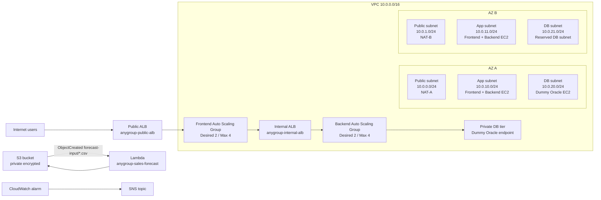

# Architecture Diagram

This diagram is the Assignment 2 deployed prototype. It remains traceable to the Assignment 1 production design but uses Learner Lab-friendly dummy services for the application and database tiers.

## Deployed endpoint

`http://anygroup-public-alb-735612210.us-east-1.elb.amazonaws.com/`

Useful demo paths:

- `/` — frontend tier.
- `/api/` — frontend to backend through the internal ALB.
- `/api/db/` — backend to private database tier.

## Production baseline differences

The Assignment 1 production architecture still recommends:

- Route 53 and CloudFront for the customer-facing domain and global delivery.
- AWS WAF and Shield for edge filtering and DDoS resilience.
- Apache/Linux frontend Auto Scaling Group.
- .NET Core/Windows backend Auto Scaling Group.
- RDS for Oracle Multi-AZ.
- Private S3 catalogue-image storage through CloudFront Origin Access Control.

The Assignment 2 deployed prototype validates the architecture mechanics under Learner Lab constraints.
